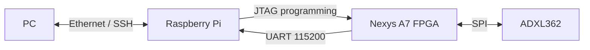

# FPGA Accelerometer Data Acquisition

Academic embedded systems project, November 2025 — Tedj El Moulk Sinacer and Chaima Jouini.

## Overview

A Nexys A7 FPGA interfaces with the on-board ADXL362 three-axis accelerometer through SPI and sends reduced-resolution measurements to a Raspberry Pi over UART. The PC accesses the Raspberry Pi through Ethernet/SSH. The presentation describes JTAG programming, Vivado synthesis and local LED display.

## Implementation

- `iclk_genr`: 100 MHz to 4 MHz clock divider; the SPI module divides again to approximately 1 MHz.
- `spi_master`: initializes the sensor (write 0x0A, address 0x2D, data 0x02), reads six bytes starting at 0x0E using 0x0B and extracts bits 11:7 of each axis.
- `uart_sender`: packages five bits per axis into three bytes, with three low bits zero; nominal 100 Hz send tick.
- `uart_tx`: 115200 baud, 8N1, LSB first, FSM-based transmitter.
- `top`: connects the clock, SPI, UART and LED outputs.

## Repository layout

- `fpga/src/`: five recovered VHDL modules (only line endings normalized).
- `fpga/constraints/`: relevant constraints extracted from the 20 November email, not a verified final XDC.
- `raspberry_pi/`: original attachment reader and reformatted email reader; pyserial dependency.
- `assets/`: four original captures.
- `docs/`: original presentation and recovery notes.
- `archive/original/`: byte-for-byte copies of six email attachments.

## Reproduction status

This is a recovered academic project, not a newly validated build. The original XPR, bitstream and testbench have not been recovered. Vivado synthesis, timing and hardware validation have not been rerun. To review the design, import the five VHDL modules and extracted XDC into a Nexys A7-100T project, set `top` as top level, review the pin mappings and unresolved outputs, then simulate before generating a bitstream.

The legacy Python reader expects axis identifiers in bits 7:6, which do not match the recovered sender. The 20 November reader matches the order and bit positions but assumes sign-magnitude rather than two's-complement, and has no frame resynchronization. The sender also needs a handshake review: `tx_busy` may not assert before the next state advances. The seven-segment component is declared but not instantiated. These are documented limitations, not verified fixes. No hardware performance claims are made.

## Attribution

Recovered from the original November 2025 email exchanges and presentation. Some attachments were forwarded from another contributor; confirm third-party permissions and attribution before public distribution. No license is asserted for the recovered source code.
